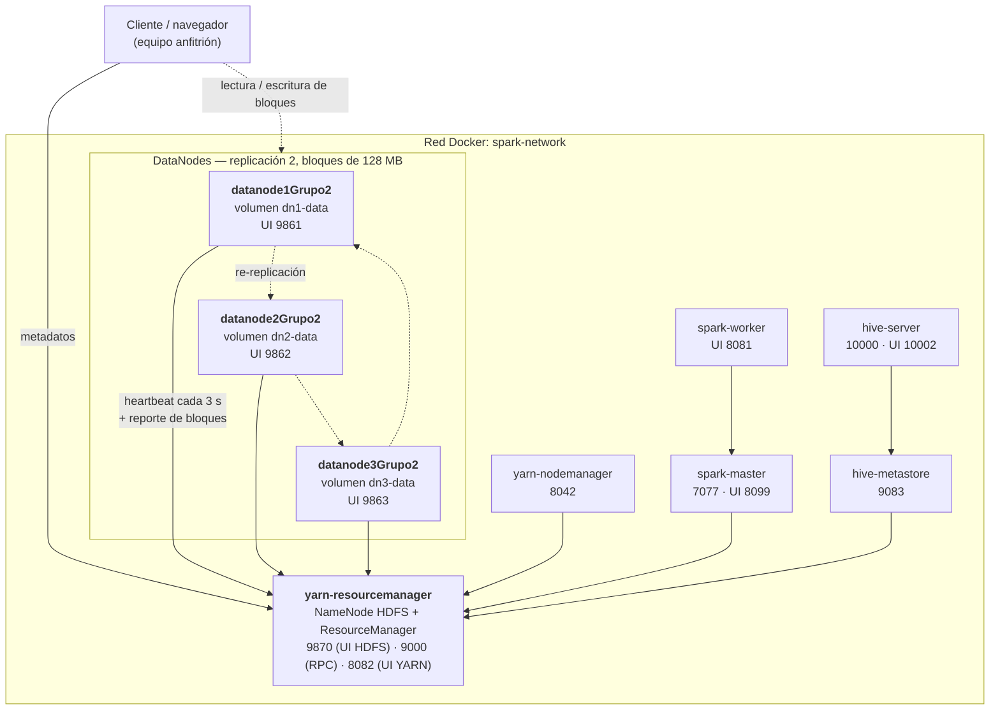

# Bigdata-Dockerspark-Transnochados — Grupo 02

Clúster Big Data con Apache Hadoop (HDFS + YARN), Spark y Hive desplegado con Docker Compose.
Sobre este clúster se realizó la práctica **LG15 – Tolerancia a fallos y replicación de datos en HDFS**:
1 NameNode, 3 DataNodes y factor de replicación 2, con pruebas de caída de un DataNode usando
datasets de 1 GB y 10 GB.

## Contenido

- [Arquitectura](#arquitectura)
- [Requisitos](#requisitos)
- [Instalación](#instalación)
- [Ejecución de la práctica LG15](#ejecución-de-la-práctica-lg15)
- [Resultados](#resultados)
- [Análisis](#análisis)
- [Comparación entre experimentos](#comparación-entre-experimentos)
- [Archivos de resultados](#archivos-de-resultados)
- [Estructura del repositorio](#estructura-del-repositorio)

## Arquitectura

| Componente | Versión |
|---|---|
| Apache Hadoop (HDFS + YARN) | 3.3.5 |
| Apache Spark | 3.4.1 |
| Apache Hive | 3.1.3 |
| Java | 8 (Eclipse Temurin) |

Todos los servicios usan la misma imagen (`dockerspark:latest`) y se comunican por la red `spark-network`.



Parámetros de HDFS relevantes para la práctica ([config/hadoop/hdfs-site.xml](config/hadoop/hdfs-site.xml)):

| Parámetro | Valor | Efecto |
|---|---|---|
| `dfs.replication` | 2 | Cada bloque se guarda en 2 DataNodes distintos |
| `dfs.blocksize` | 134217728 (128 MB, por defecto) | 1 GB = 8 bloques, 10 GB = 80 bloques |
| `dfs.heartbeat.interval` | 3 s | Frecuencia de los heartbeats |
| `dfs.namenode.heartbeat.recheck-interval` | 30000 ms | Con lo anterior, un DataNode se declara muerto a los 2 × 30 s + 10 × 3 s = **90 s** |

## Requisitos

- Docker Engine 20.10 o superior y Docker Compose v2
- 8 GB de RAM
- Unos 40 GB de disco libres (imagen + 22 GB de datasets replicados)

## Instalación

```bash
git clone https://github.com/Jhael-Elisa/Bigdata-Dockerspark-Transnochados.git
cd Bigdata-Dockerspark-Transnochados
docker compose up -d
```

La primera vez se construye la imagen y se descargan Hadoop, Spark y Hive, por lo que puede tardar varios minutos.
El clúster queda listo cuando el NameNode reporta los 3 DataNodes:

```bash
docker compose ps
docker compose exec yarn-resourcemanager hdfs dfsadmin -report
```

Interfaces web:

| Servicio | URL |
|---|---|
| HDFS NameNode | http://localhost:9870 |
| DataNode 1 / 2 / 3 | http://localhost:9861 · http://localhost:9862 · http://localhost:9863 |
| YARN ResourceManager | http://localhost:8082 |
| Spark Master | http://localhost:8099 |
| HiveServer2 | http://localhost:10002 |

Para detener el clúster: `docker compose down` (los datos de HDFS se conservan en los volúmenes).
Para borrar también los datos: `docker compose down -v`.

## Ejecución de la práctica LG15

Los scripts están en [scripts/lg15/](scripts/lg15/). Todos usan el número de grupo definido en
[scripts/lg15/config.sh](scripts/lg15/config.sh) (`GRUPO=02`), muestran los comandos `hdfs` que ejecutan
y guardan su salida en `grupo02/resultados/`.

| Paso | Comando | Qué hace |
|---|---|---|
| 1 | `bash scripts/lg15/01_preparar.sh` | Crea `/grupo02/{dataset_1GB,dataset_10GB,resultados,evidencias}` en HDFS |
| 2 | `bash scripts/lg15/02_cargar.sh <1GB\|10GB>` | Genera el dataset (CSV de ventas) y lo carga en HDFS; guarda su MD5 |
| 3 | `bash scripts/lg15/03_estado.sh <1GB\|10GB> <antes\|despues>` | `dfsadmin -report`, `fsck -files -blocks -locations` y distribución de réplicas por DataNode |
| 4 | `bash scripts/lg15/04_fallo.sh <1GB\|10GB> <1\|2\|3>` | Detiene un DataNode y monitorea hasta que se recupera la replicación |
| 5 | `bash scripts/lg15/05_leer.sh <1GB\|10GB>` | Lee el archivo completo con el DataNode caído y compara el MD5 |
| 6 | `bash scripts/lg15/06_restaurar.sh <1\|2\|3>` | Vuelve a encender el DataNode |
| 7 | `bash scripts/lg15/07_guardar_resultados.sh` | Copia los resultados a `/grupo02/resultados` en HDFS |

Secuencia ejecutada:

```bash
bash scripts/lg15/01_preparar.sh

# Prueba 1: dataset de 1 GB, falla de datanode2
bash scripts/lg15/02_cargar.sh 1GB
bash scripts/lg15/03_estado.sh 1GB antes
bash scripts/lg15/04_fallo.sh 1GB 2
bash scripts/lg15/05_leer.sh 1GB
bash scripts/lg15/03_estado.sh 1GB despues
bash scripts/lg15/06_restaurar.sh 2

# Prueba 2: dataset de 10 GB, falla de datanode3
bash scripts/lg15/02_cargar.sh 10GB
bash scripts/lg15/03_estado.sh 10GB antes
bash scripts/lg15/04_fallo.sh 10GB 3
bash scripts/lg15/05_leer.sh 10GB
bash scripts/lg15/03_estado.sh 10GB despues
bash scripts/lg15/06_restaurar.sh 3

bash scripts/lg15/07_guardar_resultados.sh
```

Archivos en HDFS:

```
/grupo02/dataset_1GB/dataset_grupo02_1GB      1 GB   (2 GB con réplicas)
/grupo02/dataset_10GB/dataset_grupo02_10GB   10 GB  (20 GB con réplicas)
/grupo02/resultados/                          salidas de los comandos
/grupo02/evidencias/
```

## Resultados

Pruebas realizadas el 11 de octubre de 2026. Las salidas completas están en [grupo02/resultados/](grupo02/resultados/).

### Prueba 1 — dataset de 1 GB, falla de datanode2

Distribución de las réplicas (8 bloques × 2 réplicas = 16):

| DataNode | IP | Antes | Con datanode2 caído (tras la recuperación) |
|---|---|---|---|
| datanode1 | 172.20.0.7 | 6 | 8 |
| datanode2 | 172.20.0.8 | 4 | 0 (caído) |
| datanode3 | 172.20.0.9 | 6 | 8 |

Línea de tiempo desde `docker compose stop datanode2`:

| Tiempo | Evento |
|---|---|
| +0 s | DataNode detenido. El archivo sigue siendo legible |
| +0 a +90 s | El NameNode aún lo cuenta como vivo (3 vivos / 0 muertos) |
| +90 s | El NameNode lo declara muerto (2 vivos / 1 muerto) |
| +113 s | `fsck`: 4 bloques subreplicados (50 %), replicación promedio 1,5, 0 bloques perdidos, estado `HEALTHY` |
| +116 s | Los 8 bloques vuelven a tener 2 réplicas |

Nuevas réplicas creadas por HDFS ([1GB_falla_datanode2_nuevas_replicas.txt](grupo02/resultados/1GB_falla_datanode2_nuevas_replicas.txt)):

```
datanode1 -> datanode3   blk_1073742101, blk_1073742105
datanode3 -> datanode1   blk_1073742102, blk_1073742106
```

Lectura completa con datanode2 caído: MD5 `4531aba60b6563905faaf534e7146250`, idéntico al original, en 4 s.

### Prueba 2 — dataset de 10 GB, falla de datanode3

Distribución de las réplicas (80 bloques × 2 réplicas = 160):

| DataNode | IP | Antes | Con datanode3 caído (tras la recuperación) |
|---|---|---|---|
| datanode1 | 172.20.0.7 | 50 | 80 |
| datanode2 | 172.20.0.8 | 59 | 80 |
| datanode3 | 172.20.0.9 | 51 | 0 (caído) |

Línea de tiempo desde `docker compose stop datanode3`:

| Tiempo | Evento |
|---|---|
| +0 s | DataNode detenido. El archivo sigue siendo legible (el cliente tarda ~1 min porque primero intenta leer el bloque 0 desde el nodo caído y luego pasa a la otra réplica) |
| +91 s | El NameNode lo declara muerto. `fsck`: 51 bloques subreplicados (63,75 %), replicación promedio 1,36, 0 bloques perdidos, estado `HEALTHY` |
| +91 a +133 s | Se re-replican 45 bloques |
| +133 a +290 s | Quedan 6 bloques pendientes mientras HDFS re-replica los demás bloques que guardaba datanode3 (archivos de `/spark/jars` y otros: unas 109 transferencias en ese intervalo según los logs de los DataNodes) |
| +296 s | Los 80 bloques vuelven a tener 2 réplicas |

Nuevas réplicas creadas por HDFS ([10GB_falla_datanode3_nuevas_replicas.txt](grupo02/resultados/10GB_falla_datanode3_nuevas_replicas.txt)):
51 en total, 30 copiadas de datanode2 a datanode1 y 21 de datanode1 a datanode2.

Lectura completa con datanode3 caído: MD5 `3116c1f7930137dcb9cc5bdf4d6f0394`, idéntico al original, en 19 s.

### Restauración

Al volver a encender el DataNode detenido, este se registra de nuevo en el NameNode con sus réplicas antiguas.
Como esos bloques ya tenían 2 réplicas en los otros nodos, HDFS elimina las sobrantes.
Estado final de `/grupo02`: 88 bloques, replicación promedio 2,0, 0 subreplicados, 0 sobre-replicados, `HEALTHY`.

## Análisis

### Antes de la falla

| Pregunta | Dataset 1 GB | Dataset 10 GB |
|---|---|---|
| ¿Cuántos bloques tenía el archivo? | 8 (de 128 MB) | 80 (de 128 MB) |
| ¿Cuántas réplicas tenía cada bloque? | 2 | 2 |
| ¿En qué DataNodes estaban? | datanode1: 6, datanode2: 4, datanode3: 6 | datanode1: 50, datanode2: 59, datanode3: 51 |

Ningún DataNode tenía el archivo completo: el NameNode elige los 2 DataNodes de cada bloque por separado.

### Durante la falla

| Pregunta | Dataset 1 GB | Dataset 10 GB |
|---|---|---|
| ¿Qué DataNode fue detenido? | datanode2 (172.20.0.8) | datanode3 (172.20.0.9) |
| ¿Qué bloques estaban almacenados en él? | 4 de 8: `blk_1073742101`, `…102`, `…105`, `…106` (bloques 2, 3, 6 y 7 del archivo) | 51 de 80 (lista en [10GB_durante_fsck.txt](grupo02/resultados/10GB_durante_fsck.txt)) |
| ¿Existían otras réplicas? | Sí, una por bloque en datanode1 o datanode3 | Sí, una por bloque en datanode1 o datanode2 |
| ¿El archivo continuó disponible? | Sí | Sí |

¿Qué cambió en HDFS? Durante los primeros 90 s nada: el NameNode solo sabe de un DataNode por sus heartbeats y
todavía no se cumple el tiempo de espera. Al cumplirse, lo marca como muerto, elimina de su mapa todas las réplicas
de ese nodo (en el reporte aparece con `Num of Blocks: 0`) y los bloques que tenían una copia allí pasan a estar
subreplicados (1 réplica viva de 2 esperadas).

### Después de la falla

| Pregunta | Dataset 1 GB | Dataset 10 GB |
|---|---|---|
| ¿Qué estado reporta HDFS? | `HEALTHY`, 2 vivos y 1 muerto | `HEALTHY`, 2 vivos y 1 muerto |
| ¿Existen bloques subreplicados? | Hubo 4; a los 116 s ya eran 0 | Hubo 51; a los 296 s ya eran 0 |
| ¿HDFS intenta recuperar automáticamente las réplicas? | Sí, creó 4 réplicas nuevas | Sí, creó 51 réplicas nuevas |
| ¿En qué DataNode se generaron las nuevas réplicas? | 2 en datanode1 y 2 en datanode3 | 30 en datanode1 y 21 en datanode2 |

**Por qué ocurrió.** El NameNode mantiene, para cada bloque, la lista de DataNodes que lo guardan y el número de
réplicas que debería tener. Cuando un DataNode deja de enviar heartbeats durante 90 s lo declara muerto y compara,
bloque por bloque, las réplicas vivas con el factor de replicación. Los bloques que quedaron con 1 réplica entran en
una cola de reconstrucción; el NameNode ordena a un DataNode que todavía tiene el bloque que lo copie a otro DataNode
vivo que no lo tenga. Esa copia va directamente de DataNode a DataNode. Como solo quedaban 2 nodos vivos y la
replicación es 2, el único destino posible para cada bloque era el otro nodo vivo, y por eso ambos terminaron con el
archivo completo. El archivo nunca dejó de estar disponible porque ningún bloque perdió sus dos réplicas a la vez.

## Comparación entre experimentos

| Característica | Dataset 1 GB | Dataset 10 GB |
|---|---|---|
| Tamaño | 1 GB (1 073 741 824 bytes) | 10 GB (10 737 418 240 bytes) |
| Número de bloques | 8 | 80 |
| Factor de replicación | 2 | 2 |
| DataNode afectado | datanode2 | datanode3 |
| Bloques afectados | 4 (50 %) | 51 (63,75 %) |
| Bloques disponibles después de falla | 8 de 8 | 80 de 80 |
| ¿Archivo accesible? | Sí (MD5 verificado) | Sí (MD5 verificado) |
| ¿Existieron bloques subreplicados? | Sí, 4 | Sí, 51 |
| Tiempo de recuperación | 116 s (90 s de detección + 26 s de re-replicación) | 296 s (91 s de detección + 205 s de re-replicación) |
| Nuevas réplicas | 4 (2 en datanode1, 2 en datanode3) | 51 (30 en datanode1, 21 en datanode2) |

Otros tiempos medidos: carga 7 s (1 GB) y 47 s (10 GB); lectura completa con un DataNode caído 4 s (1 GB) y 19 s (10 GB).

El tiempo de detección es prácticamente el mismo en las dos pruebas porque depende de los heartbeats y no del tamaño
del archivo. Lo que crece con el tamaño es la re-replicación: hay más bloques que copiar y el NameNode reparte ese
trabajo en ciclos, junto con el resto de los bloques del clúster que también perdieron una réplica.

## Archivos de resultados

Las salidas de texto de cada comando de la práctica están en [grupo02/resultados/](grupo02/resultados/):

| Archivo | Contenido |
|---|---|
| `<dataset>_antes_dfsadmin_report.txt` | Estado de los DataNodes antes de la falla |
| `<dataset>_antes_fsck.txt` | Bloques y ubicación de cada réplica antes de la falla |
| `<dataset>_antes_distribucion.txt` | Réplicas del dataset por DataNode antes de la falla |
| `<dataset>_falla_datanodeN_monitoreo.txt` | Evolución de DataNodes vivos/muertos y bloques subreplicados |
| `<dataset>_durante_fsck.txt` | `fsck` en el momento de máxima subreplicación |
| `<dataset>_falla_datanodeN_nuevas_replicas.txt` | Transferencias de re-replicación (origen → destino) |
| `<dataset>_falla_datanodeN_resumen.txt` | Bloques afectados y tiempos de recuperación |
| `<dataset>_lectura_durante_falla.txt` | Verificación MD5 de la lectura con un DataNode caído |
| `<dataset>_despues_*.txt` | Estado tras la recuperación, con el DataNode todavía caído |

## Estructura del repositorio

```
├── docker-compose.yml        Definición de los 9 servicios
├── Dockerfile                Imagen única con Hadoop, Spark y Hive
├── config/
│   ├── hadoop/               core-site, hdfs-site, yarn-site, mapred-site
│   ├── hive/                 hive-site.xml
│   └── spark/                spark-defaults.conf
├── scripts/
│   ├── entrypoint.sh
│   ├── init-hdfs.sh          Arranque del NameNode y de YARN
│   └── lg15/                 Scripts de la práctica LG15
├── grupo02/
│   └── resultados/           Salidas de los comandos de la práctica
├── test_spark_hive.py        Prueba de Spark + Hive
└── yarn_test.py              Prueba de Spark sobre YARN
```
